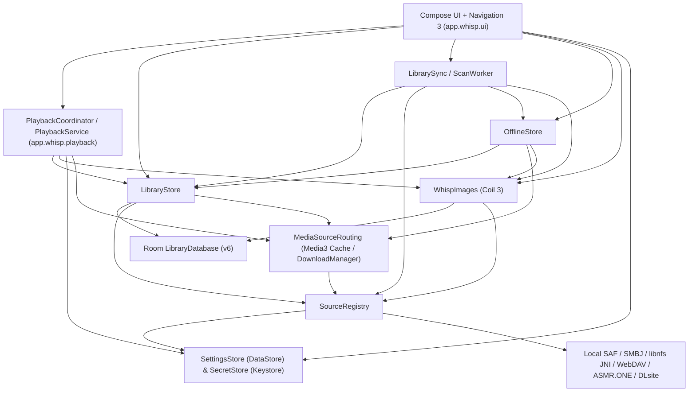

# 架构与设计

本文档面向项目贡献者与维护者，说明 Whisp 的模块分层、数据模型、播放管线与各来源协议的实现边界。

---

## 总体分层与依赖图

Whisp 在应用入口 [WhispApp.kt](../app/src/main/java/app/whisp/WhispApp.kt) 中通过扁平的 `AppGraph` 组织所有核心依赖，形成无环依赖图（DAG），避免单体 Repository 或 God ViewModel：

### 核心包与职责

| 包 / 模块 | 代表文件 | 主要职责 |
| --- | --- | --- |
| `app.whisp` | `WhispApp.kt`, `MainActivity.kt`, `DlsiteLoginActivity.kt` | `AppGraph` 依赖装配、画中画（PiP）、Android 13+ 后台多任务隐私保护、DLsite 官方登录容器 |
| `app.whisp.data` | `LibraryDatabase.kt`, `LibraryStore.kt`, `LibraryIndexer.kt`, `LibrarySync.kt`, `OfflineStore.kt` | Room 持久化、目录与作品识别、跨来源稳定 ID、后台扫描（WorkManager）与离线资源管理 |
| `app.whisp.data`（传输与来源） | `SourceRegistry.kt`, `Sources.kt`, `SmbClient.kt`, `NfsClient.kt`, `RemoteTransport.kt`, `MediaSourceRouting.kt` | 本地 SAF、SMB、NFS、WebDAV、ASMR.ONE、DLsite 的统一路由、认证与流式缓存 |
| `app.whisp.data`（字幕与文本） | `SubtitleTimeline.kt`, `TextEncoding.kt`, `TrackSections.kt`, `MediaFormats.kt` | VTT / LRC / SRT 解析、多编码自动检测、多语字幕候选匹配与录音版本/正篇附赠分组 |
| `app.whisp.playback` | `PlaybackService.kt`, `PlaybackCoordinator.kt`, `PlaybackControllers.kt`, `WhispAudioProcessor.kt`, `OfflineService.kt` | `MediaLibraryService`、ExoPlayer 生命周期、音频 DSP、硬件卸载、A–B 循环、睡眠定时与系统续播 |
| `app.whisp.ui` | `WhispRoot.kt`, `WhispRoute.kt`, `LibraryPage.kt`, `DetailPage.kt`, `PlayerPage.kt`, `VideoPlayer.kt`, `PrecisionSeekBar.kt` | Jetpack Compose 界面、Navigation 3 顶层标签独立返回栈、精细拖动进度条、视频全屏手势与共享元素转场 |
| `app/src/main/cpp` | `CMakeLists.txt`, `nfs_bridge.cpp`, `nfs_bridge_test.cpp` | `libnfs 8.0.0` 原生构建、JNI 只读桥接层与主机端 ASan/UBSan 单元测试 |

---

## 数据存储与身份模型

### Room 数据库（Schema v6）

数据库定义位于 [LibraryDatabase.kt](../app/src/main/java/app/whisp/data/LibraryDatabase.kt)，导出 Schema 存放在 `app/schemas/app.whisp.data.LibraryDatabase/`。

| 表名 | 用途与关系 |
| --- | --- |
| `sources` | 来源配置（`local` / `smb` / `nfs` / `webdav` / `asmrone` / `dlsite`）、加密凭据密文、上次扫描时间与错误信息 |
| `works` | 作品元数据（RJ 编号、当前与原始标题/声优、系列、封面、收藏、来源归属 `sourceId` ON DELETE SET NULL） |
| `tracks` | 音视频轨条目（相对路径、排序、时长、默认字幕/台本 ID、附赠标记、内联 `uri` 与大小；外键级联删除） |
| `attachments` | 字幕、台本、图片与 PDF 附赠资料（`kind`: `subtitle` / `script` / `extra-text` / `image` / `document`；外键级联删除） |
| `progress` | 每部作品的最新播放位置（`workId` 为主键，支持快速续播查询；外键级联删除） |
| `bookmarks` | 作品片段书签，支持时间点书签与带 `endMs` 的区间书签（外键级联删除） |
| `dlsite_metadata` | 按作品缓存的 DLsite 结构化介绍、创作者分工、标签与评分快照（外键级联删除） |
| `dlsite_purchases` | 按 DLsite 账号 `sourceId` 隔离缓存的已购音声目录（外键级联删除） |

迁移演进：
- **v1 → v4**：Room `AutoMigration` 自动演进。
- **v4 → v5（`MIGRATION_4_5`）**：移除旧 `locations` 表，将 `uri` 与 `size` 内联至 `tracks` / `attachments`，并为所有子表补齐外键级联约束。
- **v5 → v6（`MIGRATION_5_6`）**：为 `works(coverId)`、`works(addedAt)`、`tracks(workId, order, id)`、`progress(updatedAt)`、`bookmarks(positionMs)` 补充高频查询与排序索引。

### 稳定身份与状态持久化

- **稳定 ID**：统一通过 `stableId()` 对标识串做 Okio SHA-256 后取前 128 位十六进制编码。本地/NAS 作品按 `$sourceId|$root` 生成，确保增删单条音轨时不破坏作品身份、收藏、书签和进度；同时记录 `originalTitle` / `originalArtist`，来源刷新时自动保留用户手动编辑过的标题、声优与自定义封面。
- **设置与单曲记忆（`SettingsStore`）**：基于 Jetpack DataStore Preferences，全局设置序列化为单个 JSON 键（兼容读取 v0.5 之前的分散旧键）。同时维护有上限的 LRU 映射：
  - 单曲字幕选择（主/副双字幕，最多 200 条）
  - 单曲字幕时间轴偏移（±10 秒，最多 200 条）
  - 单曲独立进度记忆（最多 300 条）
  - ASMR.ONE 最近搜索历史（最多 20 条）
- **进度写入防抖（`ProgressWriter`）**：按 `workId` 保留待落盘队列并合并 150 ms 内的连续事件（如快速拖动/切曲）；暂停、退出与定时停止调用 `saveImmediate()` 立即落盘；写入失败时自动退避重试。

### 缓存与离线存储体系

- **在线播放流式缓存**：Media3 `SimpleCache` 搭配自定义 `AdjustableCacheEvictor`（仅使用 `Cache` 公开 API 与独立锁维护 LRU，支持运行时动态调整 64 / 128 / 256 / 512 MiB 上限）。
- **离线下载**：Media3 `DownloadManager` + `OfflineService` 管理音视频离线缓存；字幕、台本与封面等附赠资产由 `OfflineStore` 原子写入应用私有目录 `files/offline/assets/`（自动兼容迁移旧目录 `files/offline/attachments/`）。
- **图片缓存**：Coil 3 统一承担内存与磁盘封面缓存，结合永久离线资产目录与自定义封面目录 `files/custom-artwork/`。

---

## 播放引擎与音频管线

### 播放服务与音频处理

- **服务架构**：`PlaybackService` 继承 Media3 `MediaLibraryService`，在 `onConnect` 中校验外部控制器身份，向系统媒体控件与锁屏暴露播放控制、可配置步长的快进/后退按钮及最近收听续播目录。
- **低开销 PCM 音频处理器（`WhispAudioProcessor`）**：
  - 支持 16-bit PCM 与 Float PCM；所有开关均使用 `@Volatile`，切换实时生效于下一音频帧而无需重建播放器。
  - 仅开启左右声道互换或单声道合并时，走 16-bit 整数无损快路径，避免浮点往返。
  - 开启夜间防炸耳柔化时，对轻声施加约 +3 dB 增益补偿，对高于 -16 dBFS 的突发峰值以 4:1 压缩比（4 ms 快速起音 / 180 ms 平滑释放）与约 -2.5 dBFS 硬顶配合软削波膝点限制。
- **硬件 DSP 音频卸载（`AudioOffload`）**：Android 10（API 29）及以上默认启用硬件卸载以节省夜间电量；仅当 A–B 循环激活、睡眠定时需要 AP 精确调度或音频 DSP 效果开启时自动关闭卸载。开启「连续音轨无缝衔接」或变速播放时，按需向音轨选择参数声明无缝/变速硬件支持要求，设备不支持时自动回退软件路径。

### 缓冲、重试与睡眠定时

- **突发友好缓冲（`WhispLoadControl`）**：流式播放采用 25s–180s 宽滞回窗口（本地播放 15s–60s），内存上限固定 32 MiB，便于音频成批拉取后让 Wi-Fi / 蜂窝射频进入休眠，同时避免视频占用过多内存。
- **智能重试（`WhispLoadErrorHandlingPolicy`）**：对瞬时网络波动提供最多 5 次退避重试；遇到 `DlsiteLoginRequired`、`FileNotFoundException` 或 HTTP 401/403/404/410 等不可恢复错误时立即快速失败，并通过 `PlaybackErrorFormatter` 转换为面向用户的可执行提示。
- **睡眠定时（`SleepTimerController`）**：优先使用 `AlarmManager.setAndAllowWhileIdle` 在 Doze 模式下按单调时钟唤醒（保持主等待期间硬件音频卸载）；淡出窗口内申请短时 `PARTIAL_WAKE_LOCK` 按二次感知曲线平滑衰减音量，到期暂停后延迟恢复音量基准至下次播放，避免尾音爆破。

### 字幕与视频

- **字幕解析**：WebVTT 复用 Media3 `WebvttParser`（完整支持样式、注释与重叠字幕），LRC 自研支持多时间标签与 `[offset:]` 偏移，SRT 规范解析时间戳与多行文本；时间轴查找使用 Kotlin 标准库 `binarySearch`，字幕内容由 `LruCache` 缓存。
- **多编码解码（`TextEncoding`）**：按「显式 BOM（UTF-8 / UTF-16LE / UTF-16BE）→ 严格 UTF-8 校验 → 日文（Windows-31J）与中文（GB18030）字符分布打分」顺序自动判定，并支持手动强制指定编码。
- **视频渲染**：通过 Media3 `PlayerSurface` 与 Compose `ContentScale` 渲染，进入后台或开启只听模式时禁用视频轨道；视频活跃播放期间自动配置画中画（PiP）宽高比与自动进入参数（Android 12+）。

---

## 来源协议与外部接口边界

| 来源 | 核心实现 | 关键设计约束 |
| --- | --- | --- |
| **本地目录** | `LocalDirectory` | 基于 SAF `DocumentsContract`，持久化树 URI 授权，单来源索引上限 100,000 条目 |
| **SMB 2/3** | `SmbClient`（SMBJ） | 只读访问，默认强制 SMB 加密，可选局域网兼容开关；与 NFS 共用 `RemoteFileDataSource` 实现 64 位偏移随机读与 EOF 处理；播放空闲 30 秒后自动关闭空闲连接池 |
| **NFS** | `NfsClient` + `libwhisp_nfs.so` | 支持 NFS 3 / 4.0 / 4.2（TCP + `AUTH_SYS`），扫描最多 4 并发连接，读取采用 256 KiB 缓冲；详见 [原生依赖](NATIVE.md) |
| **WebDAV** | `WebDavClient`（OkHttp + SAX） | 远程强制 HTTPS；SAX 解析禁止 DTD/外部实体防止 XXE；限制最多 6 次同来源根目录内重定向 |
| **ASMR.ONE** | `AsmrOneClient` + `AsmrCatalogController` | 独立网络配置与站点 Referer；按作用域缓存分页状态（最多 6 个 LRU 作用域）；媒体使用 `whisp-asmr` 内部 URI，按需入库，不污染未打开作品的本地数据库 |
| **DLsite（元数据与账号）** | `DlsiteClient` + `DlsiteAccountClient` + `DlsiteDiagnostics` | 元数据优先请求官方完整 JSON 接口并兼容 AJAX 键值接口，Jsoup 提取结构化介绍与图片；账号会话使用 Android Keystore 加密并严格校验受信任域名；`DlsiteDiagnostics` 仅在内存环形缓冲中保留最近 64 次请求的固定阶段/状态码/耗时，防抖落盘供用户手动导出排查 |

---

## 技术栈与依赖管理

所有直接依赖版本统一维护在 [gradle/libs.versions.toml](../gradle/libs.versions.toml)，此处仅记录关键框架选型与约束：

- **UI 与导航**：Jetpack Compose + Material 3（使用 `1.5.0-beta01` 公开的 `MotionScheme` 动效接口）+ Navigation 3（每个顶层标签页独立维护返回栈与滚动状态）+ Coil 3。
- **媒体与后台**：AndroidX Media3（ExoPlayer、Session、OkHttp DataSource、UI Compose）+ WorkManager + Room + DataStore。
- **网络与协议**：OkHttp 5 + Okio + kotlinx.serialization + Jsoup + SMBJ + `libnfs 8.0.0`。
- **SDK 策略**：`compileSdk = 37`，`targetSdk = 36`，`minSdk = 26`，构建期开启 Kotlin `allWarningsAsErrors = true`。
